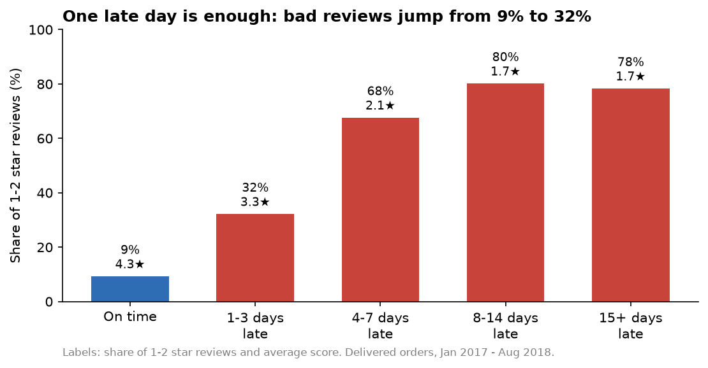

# Late deliveries cost Olist a third of its bad reviews

**6.7% of orders arrive late, but they produce 32.5% of all 1–2 star reviews.**

An end-to-end analytics project on 100K real orders from Olist, a Brazilian e-commerce
marketplace: raw CSVs → tested dbt models in DuckDB → statistical analysis → interactive
Streamlit dashboard.



## Key findings

| # | Finding | Evidence |
|---|---|---|
| 1 | **One late day is enough.** 1–3 days late triples the bad-review rate (9% → 32%). | 96,203 delivered orders |
| 2 | **Lateness itself drives the drop, not other factors.** A late order scores **1.5 stars lower** and has **8× the odds** of a 1–2 star review. | Regression controlling for category, state, order value, size and delivery time; holds in all 15 top categories and 20 states |
| 3 | **Customers judge the promise, not the speed.** The same 15–21 day delivery scores 4.2★ on time and 2.9★ late. | Being late ≈ 65 extra days of slow delivery |
| 4 | **The courier is the main cause.** 72% of late orders left the seller on time, then spent 26 days in transit (vs 7 normally). | Order timestamps for each stage |
| 5 | **Rio de Janeiro is the biggest fixable problem:** 13% of orders but 23% of late ones, only ~400 km from sellers. | Late rate by customer state |
| 6 | **Lateness spikes in peak months:** 12% in Nov 2017 (Black Friday), 19% in Mar 2018, vs 3–6% normally. | Monthly late rate |
| 7 | **A late first order slightly lowers repeat buying** (4.1% → 3.1%, p = 0.04 with controls), but only 4% of customers ever return, so the real cost is public reviews. | 55K customers with 6+ months of follow-up |

**Recommendations:** fix last-mile delivery in Rio first; set more realistic delivery promises
in late regions (customers judge the promise); plan courier capacity for peak months; enforce
ship-by dates for sellers who hand over slowly.

Full write-up with every table and method: **[docs/findings.md](docs/findings.md)**

## Dashboard

A Streamlit app with filters for month, state and category, and tabs for reviews, trend,
regions, seller vs courier, and a seller league table.

```bash
streamlit run app/streamlit_app.py
```

## How it's built

```
Kaggle CSVs (9 files)
   │  scripts/load_raw.py            load everything as text into DuckDB (schema: raw)
   │  scripts/check_raw_quality.py   19 data-quality issues found → docs/data_quality.md
   ▼
dbt staging (9 views)                types, cleaning rules, quality flags
   ▼
dbt intermediate (3 views)           items, payments and latest review per order
   ▼
dbt marts (3 tables)                 fct_orders · dim_customers · dim_sellers
   │  analysis/analysis.py           regressions, z-tests, charts → docs/findings.md
   │  app/export_data.py             4 MB Parquet for the dashboard
   ▼
Streamlit dashboard
```

**Data modelling (dbt + DuckDB)**
- 15 models in three layers, with **62 tests**: unique and not-null keys, relationships between
  tables, accepted values, and custom checks.
- Reconciliation tests make sure nothing is lost or double-counted by joins: total order value
  matches raw items to the cent, every order survives into `fct_orders`, and customer order
  counts add up.
- A seed adds English names for 2 categories missing from Olist's translation table.

**Data quality**, documented in [docs/data_quality.md](docs/data_quality.md). The decisions that
matter most:
- `customer_id` is new on every order; the real person is `customer_unique_id`, which is
  essential for any repeat-purchase analysis.
- Some reviews are linked to several orders, and some orders have several reviews; the latest
  review per order is used.
- ~1,400 orders have courier timestamps before approval; they're kept but left out of
  stage timings.
- Sparse months at both ends (late 2016, Sep–Oct 2018) are excluded from trends.

**Analysis (Python, statsmodels)**
- OLS and logistic regression with controls for category, state, value, size, multi-seller
  orders and delivery time.
- Consistency checks within every large category and state.
- Two-proportion z-test and logistic regression for repeat purchase, limited to customers with
  6+ months of follow-up.

## Run it yourself

1. Download the [Olist dataset from Kaggle](https://www.kaggle.com/datasets/olistbr/brazilian-ecommerce)
   and unzip the 9 CSVs into `data/raw/`.
2. Set up and run:

```bash
python -m venv .venv
.venv/Scripts/activate          # macOS/Linux: source .venv/bin/activate
pip install -r requirements.txt
python scripts/load_raw.py
python scripts/check_raw_quality.py
dbt build --profiles-dir .
python analysis/analysis.py
python app/export_data.py
streamlit run app/streamlit_app.py
```

To only open the dashboard, skip the download: install the requirements and run the last
line. The app reads the committed `app/data/orders.parquet`.

## Project structure

```
├── scripts/            load raw CSVs, data-quality checks
├── models/
│   ├── staging/        9 cleaned source models + tests
│   ├── intermediate/   order-level summaries
│   └── marts/          fct_orders, dim_customers, dim_sellers
├── seeds/              missing category translations
├── tests/              custom and reconciliation tests
├── macros/             haversine distance, positive-value test
├── analysis/           analysis script
├── app/                Streamlit dashboard + exported data
└── docs/               findings, data-quality report, charts
```

## Limitations

- Observational data: the regressions show strong association, not proof of cause, though the
  consistency across categories and states and the dose-response pattern make a causal link likely.
- Courier identity isn't in the data, so "courier" covers everything from seller hand-over to delivery.
- Distances are straight lines between zip-code centres.

**Tools:** Python · SQL · dbt · DuckDB · pandas · statsmodels · Matplotlib · Plotly · Streamlit
