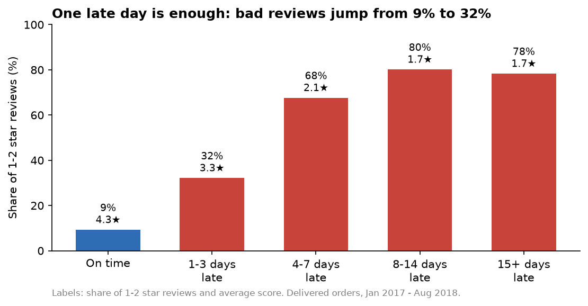
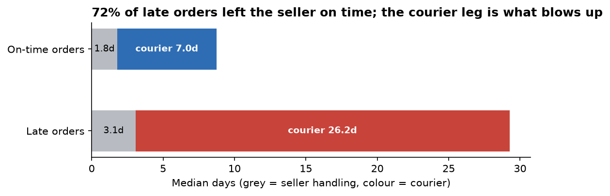
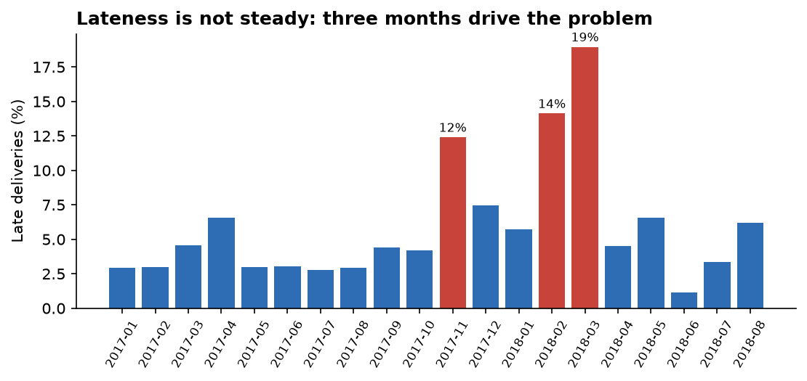
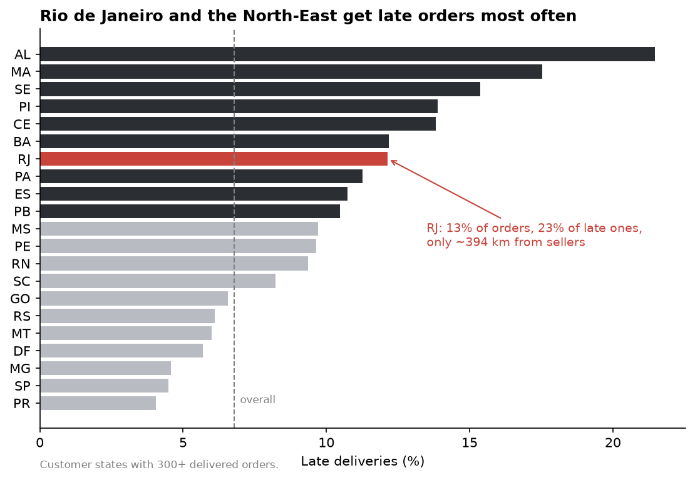
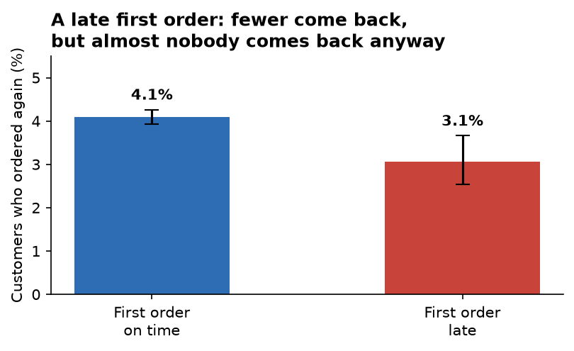

# Findings: late deliveries and review scores

**Question:** how much do late deliveries hurt review scores at Olist, and where do they
come from?

**Data:** 96,203 delivered orders purchased Jan 2017 – Aug 2018, built from the dbt marts
(`fct_orders`, `dim_customers`, `dim_sellers`). Every number below comes from
[`analysis/analysis.py`](../analysis/analysis.py); the full output is in
[`analysis_output.txt`](analysis_output.txt). "Late" means delivered after the date Olist
promised the customer at checkout.

## Summary

1. **Late orders are 6.7% of deliveries but 32.5% of all 1–2 star reviews.** About 3,400
   bad reviews (28% of all of them) would not have happened at the on-time rate.
2. **The damage starts on day one.** 1–3 days late already triples the bad-review rate (9% → 32%).
   After controlling for category, state, order value, size and delivery time, a late order
   scores **1.5 stars lower** and has **8× the odds** of a 1–2 star review.
3. **Customers judge the promise, not the speed.** A 15–21 day delivery that arrives on time
   averages 4.2 stars; the same delivery time arriving late averages 2.9.
4. **The courier, not the seller, is the main cause.** 72% of late orders left the seller on
   time. Late orders spend a median 26 days with the courier, vs 7 days normally.
5. **Rio de Janeiro is the biggest single problem.** It's 13% of orders but 23% of late ones,
   even though it's only ~400 km from most sellers. The North-East (AL, MA, SE, PI, CE, BA)
   has the highest late rates.
6. **Lateness spikes in specific months** — Nov 2017 (12%), Feb 2018 (14%) and Mar 2018 (19%),
   against 3–6% in normal months.
7. **A late first order slightly lowers repeat buying** (4.1% → 3.1%), but repeat buying is
   rare for everyone, so the real cost of lateness is reviews, not retention.

## 1. How much does lateness hurt reviews?

| Delivery | Orders | Avg score | 1–2 star share |
|---|---:|---:|---:|
| On time | 89,182 | 4.29 | 9.2% |
| 1–3 days late | 1,851 | 3.29 | 32.1% |
| 4–7 days late | 1,748 | 2.11 | 67.6% |
| 8–14 days late | 1,446 | 1.67 | 80.2% |
| 15+ days late | 1,333 | 1.72 | 78.3% |

**Is it really lateness, or something else?** Three checks:

- **It's everywhere.** In each of the 15 biggest categories, late orders score 1.75–2.27
  stars lower. In each of the 20 states with 50+ late orders, the drop is 1.63–2.33 stars.
- **It survives controls.** A regression of review score on lateness, controlling for category,
  customer state, order value, number of items, multi-seller orders and total delivery days,
  gives **–1.52 stars** for a late order (95% CI –1.57 to –1.46). A logistic regression gives
  **8.0×** the odds of a 1–2 star review (95% CI 7.4–8.7).
- **Speed alone matters much less.** In the same regression, each extra day of delivery
  costs only 0.02 stars. Being late is worth about 65 days of slower delivery.

| Delivery time | On time: avg score | Late: avg score |
|---|---:|---:|
| 0–7 days | 4.41 | 3.97 |
| 8–14 days | 4.31 | 3.27 |
| 15–21 days | 4.16 | 2.94 |
| 22–30 days | 3.94 | 2.55 |
| 30+ days | 3.63 | 1.85 |

**Side finding:** orders with items from more than one seller score 1.15 stars lower, with
everything else held equal. They likely arrive in separate parcels.

## 2. Seller or courier?

| | On-time orders | Late orders |
|---|---:|---:|
| Seller handling (median days) | 1.8 | 3.1 |
| Courier transit (median days) | 7.0 | **26.2** |
| Promised delivery (median days) | 24 | 23 |
| Seller missed its ship-by date | 8% | 28% |
| Customer in the seller's state | 37% | 24% |

- **72% of late orders were shipped by the seller on time.** The courier leg is where it
  goes wrong.
- Sellers still matter: when a seller misses its ship-by date, the order is late **21%** of
  the time, vs **5.4%** when it ships on time.
- Promises are the same for late and on-time orders (23–24 days), so lateness is not caused
  by tighter promises on those orders.

Late rates are 3–6% in most months but jump in **Nov 2017 (12%)** — the Black Friday peak,
when order volume jumped about 60% — and in **Feb–Mar 2018 (14–19%)**. The data doesn't
explain the 2018 spike: order volume was normal, so it points to a courier capacity problem
the dataset doesn't capture.

## 3. Which regions and sellers?

- **Rio de Janeiro (RJ):** 12.1% late, 12.8% of orders but **22.9% of all late orders** —
  the largest single contributor after São Paulo, which has 3× the orders. RJ customers are a
  median ~400 km from their seller, yet are late 2.7× as often as São Paulo.
- **North-East:** AL (21.5%), MA (17.5%), SE (15.4%), PI and CE (~14%), BA (12.2%).
- **The far North is fine:** AM, AP, RO, AC are under 4% late despite 2,000+ km distances,
  because their promised dates are padded (38–48 days vs ~20–25 actual).
- **Distance matters but isn't the whole story:** late rate rises from 4.5% (<100 km) to
  12.1% (2,000+ km); cross-state orders are late 8.1% of the time vs 4.5% within a state.

**Sellers:** lateness is **spread out, not concentrated**. The 100 sellers with the most late
orders account for 50% of late orders but also 42% of all orders — roughly in proportion to
their size. Among the 619 sellers with 30+ delivered orders:

| Seller late rate | Sellers | Orders | Avg score | 1–2 star share | Avg handling days |
|---|---:|---:|---:|---:|---:|
| 0–3% | 145 | 10,951 | 4.32 | 9% | 2.1 |
| 3–6% | 189 | 28,767 | 4.19 | 12% | 2.6 |
| 6–10% | 162 | 29,286 | 4.13 | 14% | 2.9 |
| 10–15% | 85 | 9,649 | 3.98 | 17% | 3.5 |
| 15%+ | 38 | 2,886 | 3.66 | 25% | 5.1 |

The worst sellers are **slow to hand over** (5.1 days vs 2.1), and their late rate tracks their
bad-review rate (correlation 0.55).

## 4. Does a late first order stop people coming back?

Customers whose first order was placed before Mar 2018 (so everyone had 6+ months to return):

| First order | Customers | Ordered again |
|---|---:|---:|
| On time | 51,560 | 4.09% (95% CI 3.92–4.26%) |
| Late | 3,667 | 3.05% (95% CI 2.54–3.66%) |

The gap is statistically significant (two-proportion z-test, p = 0.002) and holds weakly after
controlling for category, state, order value and month (odds ratio 0.82, 95% CI 0.67–0.99,
p = 0.04). But only 4% of all customers ever come back, so lateness costs Olist far more
through public reviews than through lost repeat orders.

## Recommendations

1. **Fix Rio de Janeiro first.** It's the largest share of late orders and is close to the
   sellers, so it's a courier/last-mile issue Olist can negotiate on, not a distance problem.
2. **Pad promised dates where they're missed most** (RJ and the North-East), the way they
   already are for the far North. Because customers judge the promise, a slightly longer
   promise that is kept beats a shorter one that isn't.
3. **Plan courier capacity for peaks.** Late rates triple in peak months; Black Friday is
   predictable.
4. **Enforce ship-by dates for slow sellers.** Missing the ship-by date quadruples the late
   rate; flag sellers whose handling averages 4+ days.
5. **Combine or warn on multi-seller orders**, which score 1.15 stars lower.

## Limitations

- This is observational data, so the regressions show strong association, not proof of cause.
  The consistency across every category and state, and the clear dose-response (later →
  worse), make a causal link likely.
- Courier identity isn't in the data, so "courier" means everything between the seller handing
  over the parcel and the customer receiving it.
- Distances are straight lines between zip-code centres, not road distances.
- About 1.4% of orders have out-of-order timestamps and are left out of the stage timings.
